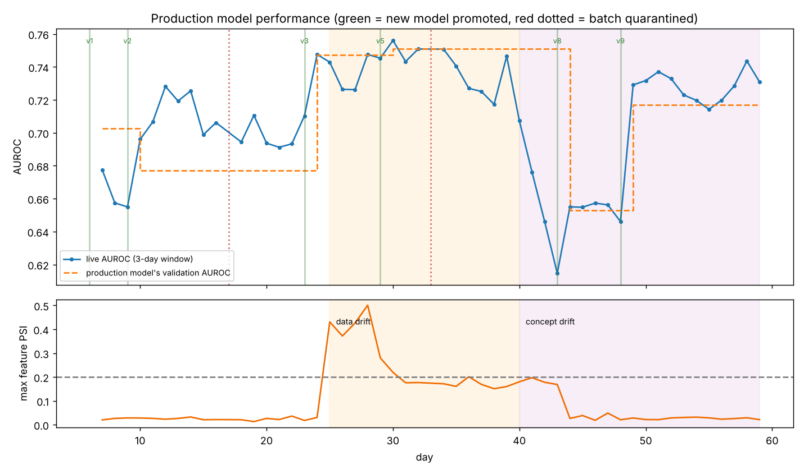
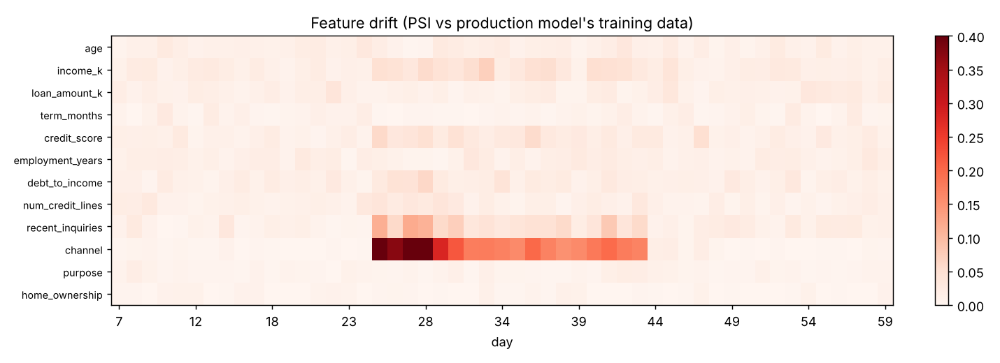
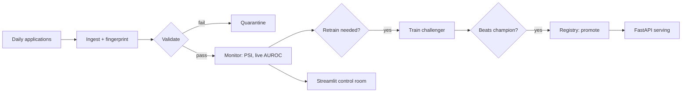

# Credit-Risk MLOps Pipeline: automated retraining that keeps AUROC at 0.73 while a frozen model decays to 0.63

**[Walkthrough notebook](notebooks/walkthrough.ipynb)** · **[Architecture](docs/architecture.md)** · **[Model card](docs/model_card.md)** · **[Runbook](docs/runbook.md)**

## Executive summary

- **Business question.** How do you keep a credit-risk model healthy once it is live, when data feeds break and customer behaviour shifts?
- **Answer.** Over 60 simulated days with planted problems, the pipeline **quarantined both corrupted batches**, caught data drift (PSI 0.43) and concept drift, retrained 9 times and **promoted only challengers that beat the champion**. In the final 10 days the live model scores **AUROC 0.727 against 0.631** for a model frozen after launch.
- **Recommendation.** Automate validation, drift checks and champion–challenger promotion; never let an unvalidated batch reach training.
- **Tools.** Airflow · scikit-learn · FastAPI · Streamlit · Docker Compose · model registry · PSI


**Problem.** A model that's accurate on launch day quietly decays: customers change, data feeds break, and the relationships the model learned stop holding. Most portfolio projects stop at "trained a model". This one is about **keeping a model healthy in production**, automatically.

**What it does.** Every day an Airflow DAG **ingests** loan applications, **validates** them (bad batches are quarantined), **monitors** the production model for data drift and performance decay, **retrains** when needed, **versions** every candidate with its data fingerprint, and **promotes** a challenger only if it beats the champion. A **Streamlit control room** shows it all, and a **FastAPI** endpoint always serves the current production version.

## Results: 60 simulated days with planted problems

| Day | Event (planted) | What the pipeline did |
|---|---|---|
| 17, 33 | Corrupted batches (25% nulls; impossible credit scores) | **Quarantined both.** Neither reached a model. |
| 25 → | **Data drift:** a new broker channel brings different applicants | PSI alert on `channel` (0.43); retrained; candidate **rejected** once, then a better one **promoted** on day 29 |
| 40 → | **Concept drift:** long loans suddenly much riskier, credit score less predictive | Live AUROC fell 0.75 → 0.62; retrained with **recency weighting**; recovered to ~0.73 |



**Did the automation matter?** Over the last 10 days, a model frozen after its first full training (v3) scores **AUROC 0.631**. The pipeline's current model scores **0.727**.

| | |
|---|---|
| Pipeline runs | 60 (2 quarantined) |
| Retraining runs | 9 (triggers: data drift 3, performance drop 3, floor 1, scheduled 1, initial 1) |
| Versions promoted / rejected | 6 / 3 |

Metrics are chosen for credit risk: **AUROC** (ranking applicants), **PR-AUC** (defaults are the minority class), **KS** (the industry-standard separation statistic) and the **Brier score** (calibration). Drift uses the **Population Stability Index**.



## The control room (Streamlit)

| Tab | Shows |
|---|---|
| Pipeline runs | colour-coded task status for every day (Airflow-style grid) and notable events |
| Model performance | live vs validation AUROC, and which version served each day |
| Data drift | PSI heatmap per feature per day |
| Data quality | validation results and quarantined batches with failed checks |
| Model registry | every version: stage, metrics, trigger, training rows, data fingerprint |
| Live scoring | sliders → default probability and risk band from the production model |

## Run it

```bash
pip install -r requirements.txt

PYTHONPATH=src python -m pipeline.orchestrate --simulate 60   # replay 60 days (~15 s)
PYTHONPATH=src python -m pipeline.report                      # figures + summary
streamlit run app.py                                          # control room
uvicorn pipeline.serve:app --app-dir src                      # API → http://127.0.0.1:8000/docs
pytest                                                        # 8 tests incl. a full 50-day simulation

docker compose up      # Airflow UI on :8080 (DAG: credit_risk_ml_pipeline), API on :8000, dashboard on :8501
```

## Architecture



## Repository structure

```
dags/                 Airflow DAG (TaskFlow API, branching, retries)
src/pipeline/
  config.py           paths, thresholds, schema
  ingest.py           source-system simulator + landing zone
  validate.py         data-quality checks → quarantine
  train.py            preprocessing + model + metrics (AUROC, PR-AUC, KS, Brier)
  registry.py         versioned model registry with data fingerprints
  monitor.py          PSI drift + live performance
  orchestrate.py      the daily pipeline as plain, testable task functions
  serve.py            FastAPI scoring with the production model
  report.py           figures and summary
app.py                Streamlit control room
models/               registry.json + versioned artifacts (v001, v002, …)
data/                 run and monitoring logs (raw batches regenerated; see data/README.md)
docs/                 architecture, model card, runbook
notebooks/            step-by-step walkthrough
```

## Governance and model risk
- **Bias:** credit models can disadvantage groups through proxies. The model card lists the subgroup checks to run before deployment (approval rate, AUROC and calibration by age band and other characteristics).
- **Explainability:** the model is decision *support*. Underwriters see a risk band, and adverse decisions need human review and reasons (UK GDPR Art. 22, FCA Consumer Duty).
- **Privacy:** pseudonymised application IDs, raw data confined to the landing zone, and quarantined data retained only for investigation.
- **Honest limitations:** synthetic data, and outcomes are assumed known the same day (real defaults take months). Recovery after concept drift is gradual because new data must accumulate.

## Next steps

- MLflow tracking server and model registry (drop-in for `registry.py`)
- Delayed-label monitoring with proxy metrics (early-delinquency rate)
- Shadow deployment of challengers before promotion
- Kubeflow Pipelines version of the DAG (see docs/architecture.md)
